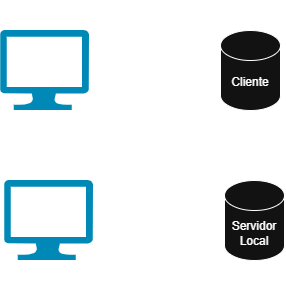

# Practica-1-Cliente-Planificador-Viajes-Con-Presupuesto
## Bloc 1 - UT1: arquitectura, llenguatges i eines
1. Preparau el projecte amb fitxers HTML, CSS i JavaScript separats. Executau-lo amb un servidor local HTTP i explicau com posar-lo en marxa.

Nosaltres posam en marxa el seridor mitjançant l'extensió de VS Code: LiveShare.

2. Explicau el paper d’HTML, CSS i JavaScript. Justificau per què JavaScript és adequat per fer càlculs i interactuar amb el navegador. Diferenciau JavaScript de TypeScript: el navegador executa JavaScript; TypeScript necessita transformació.

* HTML: És l'esquelet de la pàgina web. Defineix qu+e hi ha a la pantalla. No té estils ni lògica.
* CSS: Defineix com es veu el contingut.
* JavaScript: Defineix què fa la pàgina web. Permet que el lloc reaccioni a les accions de l'usuari.

JavaScript es el més adequat principalment per dues raons:
* Interacció directa amb el navegador a través del DOM.
* Capacitat de càlcul immediat al costat del client.

La principal diferència entre JavaScript i Typescript es que JavaScript és un llenguatge interpretat i de tipat dinàmic, mentre que TypeScript és un superconjunt de JavaScript que afegeix tipat estàtic.

3. Dibuixau un esquema senzill: el servidor local entrega els fitxers al navegador, que executa el codi. Indicau on es calculen els imports i on es guarden les dades. Explicau una diferència amb una aplicació que calcula i desa dades en un servidor.

4. Explicau un avantatge i una limitació de fer-ho al client. Aclaríeu per què aquest pressupost local no seria una reserva ni un preu fiable per confirmar una compra real.

* Avantatge de fer-ho tot al client: La immediatesa i l'estalvi de recursos. Com que els càlculs es fan directament al navegador de l'usuari, l'aplicació respon a l'instant sense temps d'espera de xarxa i el servidor no s'atura gestionant operacions.

* Limitació de fer-ho tot al client: La persistència i seguretat. Si les dades només es guarden al navegador, es perdran completament si l'usuari esborra la memòria cau, canvia de navegador o utilitza un altre dispositiu.

5. Amb Network, identificau la càrrega del fitxer JavaScript; amb Sources i Console, comprovau que s’executa. Incloeu una evidència comentada de la càrrega i una de l’execució, i explicau per a què us ha servit cada eina.

Aquí es veu com Network carrega els arxius necessàris, en aquest cas, html i script.js.

Per comprovar el funcionament del script per consola, podem afegir

~~~javascript
console.log("Hello World");
~~~

I el mostrarem per pantalla a la consola així:

Finalment, amb sources podem observar que arriben tots els arxius com indica la següent imatge.

## Bloc 2 - UT2: lògica, decisions i bucles
Començau amb dades escrites al JavaScript i sortida per consola. Encara no necessitau dates ni formulari. Cas inicial: diesText = "4"; pressupostText = "500"; transportText = "120"; preuNitText = "65"; despesaLaborableText = "30"; despesaCapSetmanaText = "45". Per a aquesta primera versió, considerau els quatre dies laborables.

1. Convertiu i validau les dades. Els dies han de ser enters entre 1 i 30. Rebutjau camps buits, text no numèric, imports invàlids i dies fora de rang amb un missatge que expliqui el problema.

2. Calculau nits, allotjament, despesa diària total, cost total, saldo disponible i mitjana per dia. Aplicau la classificació Suficient, **Ajustat** o **Insuficient.**

3. Generau amb un bucle una línia per dia: número de dia, transport, allotjament, despesa diària, cost d’aquell dia i acumulat. Comprovau que la suma del detall coincideix amb el cost total.

4. Usau variables amb noms significatius, àmbits adequats i comentaris que expliquin regles, especialment el transport únic i l’absència de nit el darrer dia.

5. Documentau una depuració: **problema**, **hipòtesi**, **pausa** o **inspecció de valors**, **correcció** i **resultat**. Pot ser un error propi o un error introduït expressament i identificat com a tal.

Control del cas inicial UT2: 4 dies, 3 nits, allotjament 195 €, despesa diària 120 €, transport 120 €, cost total 435 €, saldo 65 €, mitjana 108,75 € i estat Suficient. Acumulats diaris: 215 €, 310 €, 405 € i 435 €.