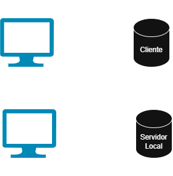
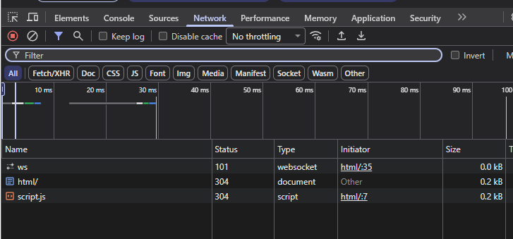
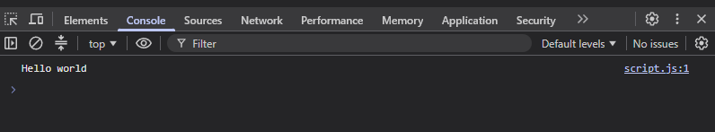

# Practica-1-Cliente-Planificador-Viajes-Con-Presupuesto
## Bloc 1 - UT1: arquitectura, llenguatges i eines
1. Preparau el projecte amb fitxers HTML, CSS i JavaScript separats. Executau-lo amb un servidor local HTTP i explicau com posar-lo en marxa.

Nosaltres posam en marxa el seridor mitjançant l'extensió de VS Code: LiveShare.

2. Explicau el paper d’HTML, CSS i JavaScript. Justificau per què JavaScript és adequat per fer càlculs i interactuar amb el navegador. Diferenciau JavaScript de TypeScript: el navegador executa JavaScript; TypeScript necessita transformació.

* HTML: És l'esquelet de la pàgina web. Defineix qu+e hi ha a la pantalla. No té estils ni lògica.
* CSS: Defineix com es veu el contingut.
* JavaScript: Defineix què fa la pàgina web. Permet que el lloc reaccioni a les accions de l'usuari.

JavaScript es el més adequat principalment per dues raons:
* Interacció directa amb el navegador a través del DOM.
* Capacitat de càlcul immediat al costat del client.

La principal diferència entre JavaScript i Typescript es que JavaScript és un llenguatge interpretat i de tipat dinàmic, mentre que TypeScript és un superconjunt de JavaScript que afegeix tipat estàtic.

3. Dibuixau un esquema senzill: el servidor local entrega els fitxers al navegador, que executa el codi. Indicau on es calculen els imports i on es guarden les dades. Explicau una diferència amb una aplicació que calcula i desa dades en un servidor.




4. Explicau un avantatge i una limitació de fer-ho al client. Aclaríeu per què aquest pressupost local no seria una reserva ni un preu fiable per confirmar una compra real.

* Avantatge de fer-ho tot al client: La immediatesa i l'estalvi de recursos. Com que els càlculs es fan directament al navegador de l'usuari, l'aplicació respon a l'instant sense temps d'espera de xarxa i el servidor no s'atura gestionant operacions.

* Limitació de fer-ho tot al client: La persistència i seguretat. Si les dades només es guarden al navegador, es perdran completament si l'usuari esborra la memòria cau, canvia de navegador o utilitza un altre dispositiu.

5. Amb Network, identificau la càrrega del fitxer JavaScript; amb Sources i Console, comprovau que s’executa. Incloeu una evidència comentada de la càrrega i una de l’execució, i explicau per a què us ha servit cada eina.

Aquí es veu com Network carrega els arxius necessàris, en aquest cas, html i script.js.



Per comprovar el funcionament del script per consola, podem afegir

~~~javascript
console.log("Hello World");
~~~

I el mostrarem per pantalla a la consola així:


Finalment, amb sources podem observar que arriben tots els arxius com indica la següent imatge.


## Bloc 2 - UT2: lògica, decisions i bucles
Començau amb dades escrites al JavaScript i sortida per consola. Encara no necessitau dates ni formulari. Cas inicial: diesText = "4"; pressupostText = "500"; transportText = "120"; preuNitText = "65"; despesaLaborableText = "30"; despesaCapSetmanaText = "45". Per a aquesta primera versió, considerau els quatre dies laborables.

1. Convertiu i validau les dades. Els dies han de ser enters entre 1 i 30. Rebutjau camps buits, text no numèric, imports invàlids i dies fora de rang amb un missatge que expliqui el problema.

2. Calculau nits, allotjament, despesa diària total, cost total, saldo disponible i mitjana per dia. Aplicau la classificació Suficient, **Ajustat** o **Insuficient.**

3. Generau amb un bucle una línia per dia: número de dia, transport, allotjament, despesa diària, cost d’aquell dia i acumulat. Comprovau que la suma del detall coincideix amb el cost total.

4. Usau variables amb noms significatius, àmbits adequats i comentaris que expliquin regles, especialment el transport únic i l’absència de nit el darrer dia.

5. Documentau una depuració: **problema**, **hipòtesi**, **pausa** o **inspecció de valors**, **correcció** i **resultat**. Pot ser un error propi o un error introduït expressament i identificat com a tal.

Control del cas inicial UT2: 4 dies, 3 nits, allotjament 195 €, despesa diària 120 €, transport 120 €, cost total 435 €, saldo 65 €, mitjana 108,75 € i estat Suficient. Acumulats diaris: 215 €, 310 €, 405 € i 435 €.

## Bloc 3 - UT3: dates, navegador i persistència

1. Afegiu camps per al nom del viatge, data de sortida, data de tornada, pressupost, transport, preu per nit, despesa laborable i despesa de cap de setmana. El nom ha de tenir contingut després d’eliminar els espais dels extrems.

2. Amb Date, calculau els dies incloent els dos extrems i identificau dissabte i diumenge. Rebutjau dates buides, invàlides, tornada anterior a la sortida o durades superiors a 30 dies. Un viatge que comença i acaba el mateix dia té un dia i zero nits.

3. Substituïu les dades fixes de UT2 per les del formulari i la seqüència de dates. Cada fila del detall ha de mostrar la data, el tipus de dia i els imports. No afegiu un selector manual del tipus de dia: s’ha de deduir de la data.

4. Mostrau el resum i el detall a la pàgina. Diferenciau visualment els tres estats del pressupost i escriviu també el nom de l’estat. Si les dades són invàlides, mostrau un error comprensible i no presenteu un resultat anterior com si correspongués a les dades noves.

5. Afegiu les accions Calcular, Guardar, Recuperar, Esborrar el desat i Obrir resum. Guardau només una planificació vàlida amb JSON i localStorage. En recuperar-la, ompliu els camps, validau i recalculau; no confieu només en totals guardats.

6. Comprovau que es pot recuperar després de recarregar. Informau quan no hi ha dades, quan el contingut desat és invàlid o quan no es pot accedir a l’emmagatzematge. Esborrau només la clau de la vostra aplicació.

7. Des d’un clic a Obrir resum, mostrau el darrer càlcul vàlid en una segona finestra o pestanya, amb nom, dates, resum i detall. Si l’obertura és bloquejada, informau l’usuari. No obriu finestres automàticament en carregar.

8. Identificau al document els usos de Date, document, window, JSON i localStorage. Explicau què resol cada un en el vostre projecte.
Atenció a les dates: comptau dies de calendari, no hores locals transcorregudes. El canvi d’hora no ha de crear un dia de més o de menys. Podeu usar una representació UTC coherent per fer els càlculs i recórrer les dates.

El resum ha d’identificar el càlcul que mostra. Si es modifiquen els camps, cal recalcular abans de guardar o obrir el resum. Repetir Calcular amb les mateixes dades no ha de duplicar files ni acumular imports anteriors.

Lliurable UT3: funcionalitats de navegador integrades i registre de proves de dates, pàgina, persistència i segona finestra. La finestra o pestanya pot ser la que decideixi el navegador.


### Bloc 2 punt 5
### Depuració (error introduït expressament)

Per practicar la depuració hem introduït **expressament** un error a `generarDetallePorDia()` (`js/script_bloque2.js`). Hem canviat la condició de l'allotjament:

```javascript
// Versió amb l'error introduït
const alojamientoDia = (dia <= diesNumber) ? preuNitNumber : 0;
```

**Problema:** a la consola, l'acumulat del darrer dia era 500 € però el cost total era 435 €. `comprobarDetalle()` mostrava `¿Coincide?: false`.

**Hipòtesi:** la diferència és exactament de 65 €, que és el preu d'una nit. Pensam que el detall cobra allotjament també el darrer dia, quan no s'hi dorm.

**Pausa i inspecció de valors:** a *Sources* hem posat un punt d'interrupció a la línia de `alojamientoDia` i hem avançat dia a dia. Hem inspeccionat `dia`, `diesNumber` i `alojamientoDia`:

| dia | diesNumber | alojamientoDia |
|---|---|---|
| 1 | 4 | 65 |
| 2 | 4 | 65 |
| 3 | 4 | 65 |
| 4 | 4 | **65** ← hauria de ser 0 |

Amb `dia = 4` la condició `4 <= 4` és certa i es cobra una nit de més.

**Correcció:** canviam `<=` per `<`. Així el darrer dia no té nit:

```javascript
// El darrer dia no es dorm fora: no hi ha allotjament
const alojamientoDia = (dia < diesNumber) ? preuNitNumber : 0;
```

**Resultat:** els acumulats tornen a ser 215 €, 310 €, 405 € i 435 €. La suma del detall coincideix amb el cost total (`¿Coincide?: true`), igual que el cas de control.


### Bloc 3 punt 8
### Usos de Date, document, window, JSON i localStorage

| Objecte | On l'usam | Què resol |
|---|---|---|
| `Date` | `calculateDaysBetweenDates()` i `generarTablaDetalle()`. També `new Date()` en calcular, per saber quan s'ha fet el càlcul. | Converteix les dates del formulari en dates que podem comparar. Calcula quants dies dura el viatge (incloent-hi la sortida i la tornada), detecta si cada dia és dissabte o diumenge (`getUTCDay()`) i avança d'un dia en un dia. Al resum mostra l'hora del càlcul. |
| `document` | `getElementById()`, `textContent`, `createElement()`, `appendChild()`, `innerHTML` i `addEventListener()` | És el DOM, el pont entre el JavaScript i la pàgina. Permet llegir i omplir els camps, pintar el resum i la taula de detall sense recarregar, mostrar missatges i reaccionar als clics dels botons. |
| `window` | `window.open('', '_blank')` al botó *Obrir resum* | Obre una segona pestanya o finestra amb el darrer càlcul vàlid. Si el navegador la bloqueja, `window.open` retorna `null` i ho comunicam a l'usuari. Només s'obre amb un clic, mai en carregar la pàgina. |
| `JSON` | `JSON.stringify()` a *Guardar* i `JSON.parse()` a *Recuperar* | `localStorage` només desa text. `stringify` converteix l'objecte amb els camps en text i `parse` el torna a convertir en objecte. Si el text desat està malmès, `parse` llança un error que capturam amb `try/catch` per avisar que el contingut no és vàlid. |
| `localStorage` | `setItem()`, `getItem()` i `removeItem()` amb la clau `planificadorViajes.planificacion` | Guarda la planificació al navegador perquè es pugui recuperar després de recarregar o tancar la pàgina. Desam només els camps, no els totals: en recuperar, tornam a validar i recalcular. Esborram només la nostra clau (`removeItem`, mai `clear()`), i totes les crides van dins `try/catch` per si el navegador no hi deixa accedir. |